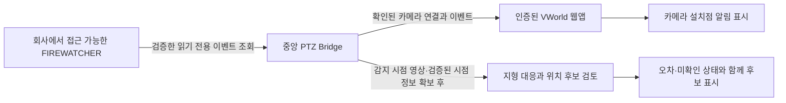

# AI 연기감지 알림을 지도에 표시하기

## 확인 상태와 표시할 위치

사용자가 제공한 FIREWATCHER 화면에서 카메라 이름·감지 시각·영상의 빨간 감지 박스를 확인했습니다.
관리 페이지 접속 문제는 사용자가 VPN 때문이라고 확인했습니다. 사용자는 개인 PC에서 문자 알림 링크가 열린다고 확인했습니다.
조회 API·인증 방식·원본 해상도·박스 형식·시간대는 아직 확인하지 않았습니다.
알림 화면의 지도 핀이 카메라 설치점인지 실제 연기 발생점인지도 미확인입니다.

2026-10-30 사용자 확인에 따라 일반 문자 수신을 통한 경로도 검토합니다. 온라인 전용번호를 먼저 확인하고, 적합한 서비스가 없을 때 휴대폰 자동전달을 검토합니다.
공식 규격으로 검증된 공급업체는 아직 없으며 SMS 어댑터도 아직 구현하지 않았습니다. 선정 조건과 문의문은 [온라인 문자 수신 검토](sms-alert-reception.md)에 정리했습니다.

**카메라 알림 표시와 연기 발생 위치 산출은 별도 단계입니다.**
동일 장비를 확인하면 알림을 카메라 설치점에 표시할 수 있습니다.
영상의 빨간 박스만으로는 발화 지점의 좌표를 확정할 수 없습니다.
회전형 카메라이므로 감지 시점의 방향·기울기·줌과 화각이 필요합니다.
수동 시안이나 과거의 보정값을 감지 당시의 실제 방향으로 자동 적용하지 않습니다.

## 지금 사용할 수 있는 시안

지도 상단 **AI 감지 알림**을 누릅니다. 자동수신은 아직 연결하지 않았습니다.

1. **알림 한 건 직접 입력**에서 출처·사무소, 카메라 이름과 한국시간의 감지 시각을 입력합니다.
   출처 카메라 ID를 모르면 이름을 사용할 수 있으며 ID는 후속 확인 대상입니다.
   입력 시 생성하는 `operator-…` 번호는 이 시안의 참조 번호이며 원본 시스템의 이벤트 번호가 아닙니다.
2. **동일 장비로 확인한 지도 카메라**를 직접 선택합니다. 이름 유사도로 자동 연결하지 않습니다.
   예를 들어 AI 카메라 이름과 지도 위치 이름이 비슷해도 동일한 장비인지는 확인해야 합니다.
3. 연결한 설치점에 붉은 테두리와 **카메라 위치 · 연기 위치 미확인** 문구가 표시됩니다.
   한 카메라의 여러 입력 알림은 건수로 묶습니다. 이는 진행 중인 화재 건수나 현재 활성 알림 상태를 뜻하지 않습니다.
   마커를 선택하거나 **연결 카메라 지도 보기**로 이동할 수 있습니다.
4. 정규화 파일에 박스가 있다면 **이 알림의 참조 영상**을 직접 선택해 비교할 수 있습니다.
   감지 시각·장비와의 일치는 운영자가 확인해야 합니다. 이미지 크기가 원본 프레임 크기와 정확히 같을 때만
   박스를 표시합니다. 축소 화면이나 UI가 포함된 캡처를 원본으로 간주하지 않습니다.

지도 좌표가 변경되거나 연결된 카메라가 제거되면 재확인이 필요합니다.
출처·카메라 ID·카메라 이름이 바뀌면 기존 연결을 자동으로 이어받지 않습니다.
가상 시점 보정 중에는 알림 마커를 숨깁니다. **알림 카메라 표시**로 표시 여부를 조정할 수도 있습니다.

알림 자료·연결·참조 영상은 브라우저 메모리에만 유지합니다. 새로고침하면 사라집니다.
입력과 파일 선택은 서버에 업로드하지 않습니다. **이 화면의 알림 자료 지우기**는 이 시안만 비우며
FIREWATCHER의 알림 해제·확인·삭제 기능을 호출하지 않습니다.
현재 Pages에는 로그인과 실제 이벤트 수신이 없고 실제 운영 알림·이미지를 기본 데이터로 공개하지 않습니다.

## 시안의 파일 형식

아래는 우리가 정의한 **운영자 입력용 형식**이며 FIREWATCHER 원본 API 형식을 확인한 결과가 아닙니다.
정규화 알림 JSON 불러오기는 이 형식만 받습니다. 예시는 합성 데이터입니다.

```json
{
  "schemaVersion": 1,
  "kind": "smoke-alert-preview",
  "source": "operator-input",
  "sourceInstance": "합성 시험 사무소",
  "events": [
    {
      "eventId": "synthetic-event-1",
      "cameraKey": "synthetic-camera-1",
      "cameraName": "합성 AI 알림 카메라",
      "detectedAt": "2026-10-13T09:00:00+09:00",
      "frameSize": { "width": 640, "height": 360 },
      "box": { "x": 220, "y": 80, "width": 30, "height": 40 }
    }
  ]
}
```

시각은 시간대를 포함한 ISO 형식이고 이벤트 번호는 파일 안에서 중복될 수 없습니다.
`box`는 원본 영상의 왼쪽 위가 원점인 픽셀 단위 직사각형입니다. 정규화 비율이나 다른 좌표 형식은
그 의미를 확인한 뒤 변환해야 합니다. 박스가 없으면 `box: null`, 원본 크기도 모르면 `frameSize: null`로 둡니다.
박스에는 원본 크기가 필수이며 프레임 밖 박스를 거부합니다. 최대 1MB·500건입니다.
계정·토큰·쿠키·장비 접속 주소·원격 이미지 URL 등 추가 필드는 받지 않습니다.

## 회사 PC에서 다음에 확인할 것

기존에 정상 접속하는 브라우저에서 확인하며 설정을 변경하거나 알림을 해제할 필요가 없습니다.

1. 대시보드를 열고 **F12 → Network → Fetch/XHR**로 이동합니다.
2. 새로고침 또는 기존 알림 목록 조회를 한 뒤 이벤트 목록을 반환하는 요청을 찾습니다.
   **요청 경로, 메서드(GET 등), HTTP 상태, 응답 필드 이름**을 기록합니다.
   실제로 GET이 아닌 조회 방식이면 그대로 기록하며 임의로 POST 요청을 재실행하지 않습니다.
3. 응답에서 다음 항목이 있는지 확인합니다.
   - 이벤트 고유 번호, 출처 카메라 ID·이름, 감지 시각과 시간대.
   - 이미지 원본 해상도, 박스 좌표 필드와 단위(픽셀·비율 등).
   - 위도·경도가 있다면 **카메라 위치인지 감지 대상 위치인지**를 설명하는 문서나 필드.
   - 페이지·커서·전체 개수와 전체 조회 완료 조건, 중복 또는 상태 변경을 구별할 필드.
4. Fetch/XHR에서 보이지 않고 **WS** 연결이 있다면 Messages의 이벤트 필드 이름과
   연결 경로만 확인합니다. WebSocket을 새로 열거나 기존 메시지를 임의로 보내지 않습니다.

공유할 때는 경로의 쿼리 값과 토큰을 제외하고 필드 이름 또는 값을 치환한 최소 예시를 사용합니다.
HAR 전체, Copy as cURL, 쿠키·Authorization·비밀번호·서명된 이미지 URL은 보내지 않습니다.
확인이 어렵다면 공급업체의 읽기 전용 이벤트 API 문서나 정상 UI의 내보내기 형식으로 같은 항목을 확인합니다.
운영 인증 정보는 회사의 중앙 Bridge 설정에만 보관하며 Pages 빌드나 채팅에 넣지 않습니다.

## 실제 자동연동 구조



목록 조회인지 이벤트 구독인지, 인증과 배포 방식은 회사 응답을 확인한 뒤 결정합니다.
현재 저장소에 실제 FIREWATCHER 네트워크 어댑터는 구현하지 않았습니다.
공개 Pages에서 회사 서비스에 직접 접속하는 경로를 만들지 않으며 CORS·인증·접속 제한을 우회하지 않습니다.
운영 알림 제공 전에는 중앙 Bridge와 웹앱의 직원 인증·접근 권한도 구성해야 합니다.

## 연기 위치까지 산출하려면

카메라 설치 좌표에 더해 지면 높이와 렌즈 높이, 감지 당시의 영상·방향·기울기·화각,
영상 왜곡과 픽셀 대응, 지형상의 확인 가능한 기준점이 필요합니다.
검증된 시점에서 박스 픽셀을 시선으로 바꿔 지형과 만나는 위치를 구할 수 있지만,
이는 배경 지형의 위치 후보입니다. 공중의 연기는 배경 지점에서 발생했다고 볼 수 없습니다.
연기 밑부분·바람·가림·거리 오차를 검토하고 다른 카메라의 동시 관측이 있으면 교차 확인합니다.
지금의 3m 시험 높이, 수동 관측 범위 및 정지 영상 보정은 정확도가 검증된 실시간 감지 시점 정보가 아닙니다.
좌표가 검증된 뒤 기존 **위치·지번** 조회로 주소를 보조 확인할 수 있습니다.
